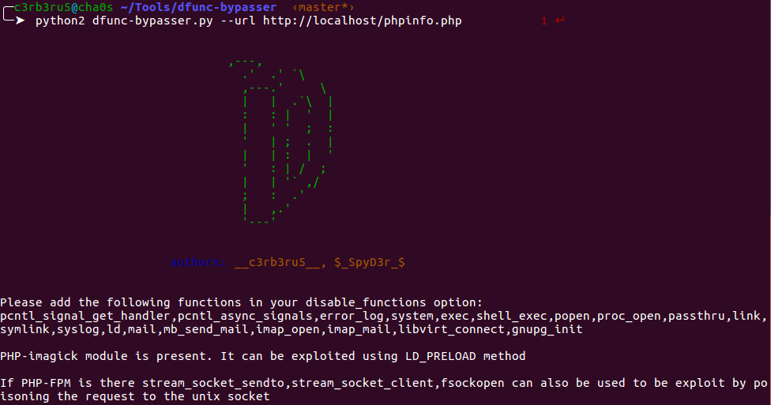
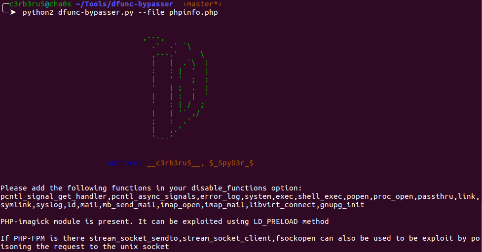

# Dfunc-Bypasser
This is a tool that can be used by developers to check if exploitation using LD_PRELOAD is still possible given the current disable_functions in the php.ini file and taking into consideration the PHP modules installed on the server.

## Installation
`git clone https://github.com/JordaoMbambu/dfunc-bypasser-python3`

## Usage
There are two options to input the disable_functions list:
1. For help on the parameters:
`python3 dfunc-bypasser.py -h`
2. Provide the phpinfo url:
`python3 dfunc-bypasser.py --url https://example.com/phpinfo.php`
3. Provide the local phpinfo file:
`python3 dfunc-bypasser.py --file dir/phpinfo`

## Contributers
1. S Ashwin Shenoi
    * Github: [ashwinshenoi99](https://github.com/ashwinshenoi99)
    * Twitter: [c3rb3ru5](https://twitter.com/__c3rb3ru5__)
2. Tarunkant Gupta
    * Github: [tarunkant](https://github.com/tarunkant/)
    * Twitter: [TarunkantG](https://twitter.com/TarunkantG)
3. Jordao MBambu
    * Github: [JordaoMbambu](https://github.com/JordaoMbambu)
    * Linkedin: [JordaoMBambu](https://www.linkedin.com/in/jordaombambu)
      

from team [bi0s](https://bi0s.in)
from team [hackersonsteroids](https://hos.team)

## Screenshots

